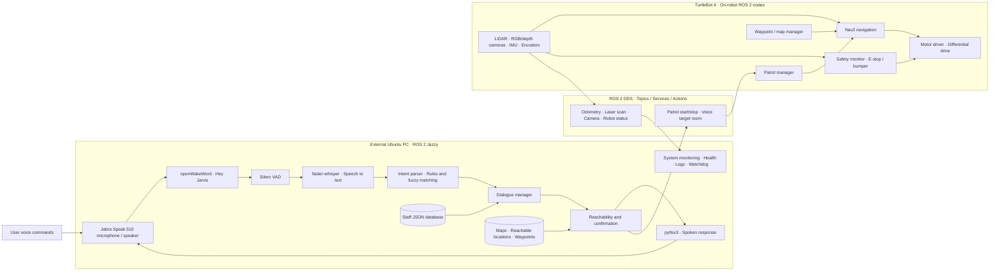

# J.A.R.V.I.S. — TurtleBot 4 Campus Assistant & Smoke Detection

Graduation project combining **TurtleBot 4 autonomous navigation**, a **ROS 2 voice assistant**, **computer vision smoke detection**, and a **Flutter security-review application**. The repository also includes a **separate TurtleBot3 simulation and ML demonstration**, documented below.

## Explore the graduation project

| Component | Evidence / source |
| --- | --- |
| Selected trained smoke detector | [jarvis-best-new.pt](jarvis-best-new.pt) |
| Flutter mobile app | [jarvis-app/lib/main.dart](jarvis-app/lib/main.dart) |
| Python detection bridges | [jarvis-app/integration_bridge](jarvis-app/integration_bridge) |
| Architecture and workflows | [J.A.R.V.I.S. project overview](docs/jarvis-project-overview.md) |
| Training comparison | [Four-run evaluation](docs/jarvis-project-overview.md#smoke-detection-model-evaluation-supplied-project-results) |
| Robot mapping and localization | [Mapping evidence](docs/real-world-mapping.md) |
| Supplementary simulation | [TurtleBot3 ROS 2 demonstrator](#supplementary-turtlebot3-simulation-and-ml-demonstrator) |

### Project demonstration media

Two project videos have been reviewed and prepared for publication: **Campus Demonstration** (2:18, robot in an indoor university setting) and **Robot Hardware Showcase** (1:03, close-up of the mobile base and mounted head). The compressed videos are not yet hosted in this repository; see [demonstration media guide](docs/DEMO_MEDIA.md). These videos should not be treated as independent validation of the smoke-detection model or voice assistant. The current [system architecture](#architecture) is an editable Mermaid rendering of the supplied TurtleBot 4 design.

### Selected model performance (project-reported)

| Precision | Recall | mAP@0.5 | Best F1 |
| ---: | ---: | ---: | ---: |
| 0.921 | 0.909 | 0.955 | 0.910 |

These are results reported in the supplied project materials for selected Run 4, not independently rerun results.

## Portfolio evidence at a glance

See **[AI project status](docs/PROJECT_STATUS.md)** for a per-component implementation, training, testing, and validation matrix, and **[AI interview walkthrough](docs/AI_INTERVIEW_WALKTHROUGH.md)** for technical explanations. This repository includes the graduation project's selected trained smoke-detection checkpoint [`jarvis-best-new.pt`](jarvis-best-new.pt), alongside a separate small smoke-classification baseline and an optional YOLO training utility. These are distinct artifacts.

### Trained smoke-detection model

The graduation project's **selected newer trained smoke-detection checkpoint** is **[`jarvis-best-new.pt`](jarvis-best-new.pt)**. The earlier [`best.pt`](best.pt) remains available as a previous checkpoint. This is the uploaded model artifact for the J.A.R.V.I.S. smoking-detection component. The separate training utility in `scripts/train_yolo_smoke.py` can be used for additional experiments; it is **not** the source of the uploaded checkpoint.

## J.A.R.V.I.S. mobile application and smoke-detection evaluation

The [browsable Flutter application and Python integration source](jarvis-app/) contains the campus-assistant application with robot start/stop, patrol control, navigation destinations, security review, and reviewed-detection screens. The integration archive includes Python adapters for still images, live/streamed video, and ROS camera topics. See [J.A.R.V.I.S. project documentation](docs/jarvis-project-overview.md) for the architecture and source-asset inventory.

The supplied model-comparison results identify **Run 4 (phone/pen/background fine-tune)** as the selected smoke detector: **precision 0.921, recall 0.909, mAP@0.5 0.955, best F1 0.910**. These are project-reported results; the underlying evaluation data has not been rerun here.

**Checkpoint selection:** Use `jarvis-best-new.pt` for the project's selected Run 4 model. The repository-root `best.pt` is retained as an older checkpoint. When running the integration bridge, configure its model path to point to the selected checkpoint; do not silently default to the older weights.

## Supplementary TurtleBot3 simulation and ML demonstrator

The following section documents the **separate portfolio implementation**, not the original TurtleBot 4 graduation-project software.

### Implemented components

- TurtleBot3 **Waffle Pi** in Gazebo Harmonic with ROS2 Jazzy: camera, LiDAR, odometry and an occupancy map.
- SLAM Toolbox mapping and Nav2 path planning, local costmaps and obstacle avoidance.
- A separate supervisor gates navigation commands, stops on stale camera/laser data and nearby obstacles, and latches visual alerts until manually reset.
- A small **newly trained smoke checkpoint** from a public D-Fire subset, with camera classification and JSON alerts.
- A temporal CNN/GRU training and inference implementation for eight-frame video clips. **A real violence detector is not trained or included:** the proposed RWF-2000 source currently withholds downloads. Synthetic clips validate the software path only.

This supplementary implementation is a portfolio demonstrator. The smoke baseline misses many events, and the supervisor does not cover a complete robot footprint or every failure mode. It is unsuitable for unattended safety or surveillance decisions. No hardware testing or production deployment is claimed.

## Architecture

The following diagram reflects the **TurtleBot 4 Campus Guide & Security Robot** integrated system architecture supplied with the graduation project, rather than the separate TurtleBot3 simulation demonstrator described elsewhere in this repository.



**Related workflows:** [J.A.R.V.I.S. architecture and workflows](docs/jarvis-project-overview.md) covers voice interaction, navigation/patrol startup, and the separate two-stage smoke-detection and human-review pipeline.

### Design choices you can discuss

- **Use upstream SLAM and navigation:** SLAM Toolbox estimates the map and pose; Nav2 plans paths and controls motion. Reusing these tested components leaves clear space for application logic. Their algorithms are not claimed as code written here.
- **Decision-level camera/LiDAR fusion:** laser clearance and camera freshness/alerts jointly affect the velocity gate. This is not calibrated geometric fusion, camera depth estimation or 3D obstacle reconstruction.
- **Separate command topics:** Nav2 outputs `/cmd_vel_nav`; only the supervisor publishes robot `/cmd_vel`. The launch uses stamped velocity messages for the pinned Jazzy TurtleBot3 configuration. This separation makes the gate observable and testable.
- **Wall-clock watchdogs:** sensor receipt and command age use a monotonic clock, so a paused simulation cannot leave a command considered fresh forever. Receipt freshness does not detect every delayed or repeated frame.
- **Explicit alert latch:** three consecutive classifier scores at least 0.5 emit an active alert; the supervisor remains stopped until reset. The threshold is a baseline choice, not calibrated confidence or a guaranteed false-alarm rate.
- **Small CNN plus GRU:** each 64×64 RGB frame becomes a spatial feature vector. A GRU summarizes a sequence; smoke uses one frame and the video path uses eight. This keeps CPU inference small, at the cost of fine visual detail.
- **Split before training:** manifests define train/validation/test and source groups. Duplicate media bytes and groups shared between splits are rejected. Best epoch is selected by validation macro F1; test data is evaluated after selection.

## Stack and sources

Python 3.12, ROS2 Jazzy, Gazebo Harmonic, TurtleBot3 Waffle Pi, SLAM Toolbox, Nav2, OpenCV, PyTorch, scikit-learn and pytest. Target OS: Ubuntu 24.04. No Firebase, cloud API or credentials are required.

| Component | Source | Terms |
|---|---|---|
| New code and small checkpoint | This reconstruction | MIT |
| TurtleBot3 simulation and `config/nav2.yaml` | [ROBOTIS](https://github.com/ROBOTIS-GIT/turtlebot3_simulations) | Apache 2.0; config license included |
| D-Fire images/labels | [GAIA authors](https://github.com/gaia-solutions-on-demand/DFireDataset), [author-linked Kaggle mirror](https://www.kaggle.com/datasets/sayedgamal99/smoke-fire-detection-yolo) | Collection published under CC0 1.0; originals remain local |
| Proposed RWF-2000 videos | [Cheng, Cai and Li](https://github.com/mchengny/RWF2000-Video-Database-for-Violence-Detection) | Restricted; no redistribution/modification/commercial use without approval; downloads currently withheld |

D-Fire credit: Pedro Vinícius Almeida Borges de Venâncio, Adriano Chaves Lisboa and Adriano Vilela Barbosa, *An automatic fire detection system based on deep convolutional neural networks for low-power, resource-constrained devices*, Neural Computing and Applications (2022).

RWF-2000 credit: Ming Cheng, Kunjing Cai and Ming Li, *RWF-2000: An Open Large Scale Video Database for Violence Detection*, ICPR (2021), DOI 10.1109/ICPR48806.2021.9412502. No mirrored videos with conflicting license claims were used.

## ROS2/Gazebo setup

Install ROS2 Jazzy using the [official Ubuntu guide](https://docs.ros.org/en/jazzy/Installation/Ubuntu-Install-Debs.html), then:

```bash
sudo apt install ros-jazzy-ros-base ros-jazzy-ros-gz ros-jazzy-turtlebot3 \
  ros-jazzy-turtlebot3-msgs ros-jazzy-slam-toolbox ros-jazzy-navigation2 \
  ros-jazzy-nav2-bringup python3-colcon-common-extensions python3-venv
source /opt/ros/jazzy/setup.bash
mkdir -p ~/tb3_ws/src
cd ~/tb3_ws/src
git clone -b jazzy https://github.com/ROBOTIS-GIT/turtlebot3_simulations.git
git -C turtlebot3_simulations checkout 45633014a14e8f438495b532a723e4ad45cbbd31
git clone https://github.com/adhamamerrrr/autonomous-turtlebot-ai.git
cd ~/tb3_ws
/usr/bin/python3 -m venv --system-site-packages .venv
source .venv/bin/activate
python -m pip install torch --index-url https://download.pytorch.org/whl/cpu
python -m pip install -r src/autonomous-turtlebot-ai/requirements.txt
python /usr/bin/colcon build --symlink-install --cmake-args -DPython3_EXECUTABLE=/usr/bin/python3
source install/setup.bash
ros2 launch autonomous_turtlebot_ai sim.launch.py
```

The default launch runs Gazebo headless. Gazebo's first run downloads upstream ground-plane and sun assets. Use `gz sim -g` in another terminal if you have a desktop and want its GUI. The repository includes the selected newer graduation-project smoke-detection weights at `jarvis-best-new.pt` and an earlier checkpoint at `best.pt`. The ROS2 simulation's separate small smoke-classification checkpoint is a different model and is not automatically replaced by `best.pt`. Violence detection reports disabled rather than silently pretending to predict no events.

Open a second terminal, source ROS2, the virtual environment and workspace, then:

```bash
cd ~/tb3_ws/src/autonomous-turtlebot-ai
python scripts/check_sim.py
ros2 topic echo /portfolio/alerts
```

`check_sim.py` observes sensor topics and the map, sends a short relative navigation goal and asserts success. Run it in a clear initial world; it is not a comprehensive navigation benchmark. For manual goals use RViz/Nav2 or a `NavigateToPose` action. Mapping requires motion; this reconstruction does not implement autonomous frontier exploration.

Save your generated map:

```bash
mkdir -p maps
ros2 run nav2_map_server map_saver_cli -f maps/demo
```

Reset a latched alert after inspecting the cause:

```bash
ros2 service call /portfolio/reset_alert std_srvs/srv/Trigger '{}'
```

For a separately trained video model:

```bash
ros2 launch autonomous_turtlebot_ai sim.launch.py violence_model:=/absolute/path/violence.pt
```

## Reproduce smoke training

The downloader retrieves approximately 3 GB of public images but extracts only the selected subset. Keep the archive and media out of git.

```bash
cd ~/tb3_ws/src/autonomous-turtlebot-ai
python scripts/prepare_dfire.py
python -m autonomous_turtlebot_ai.train --task smoke \
  --manifest data/dfire-small/manifest.csv --data-root data/dfire-small \
  --output models/smoke --epochs 15 \
  --source https://www.kaggle.com/datasets/sayedgamal99/smoke-fire-detection-yolo
python scripts/predict_smoke.py /path/to/an/image.jpg --model models/smoke/smoke.pt
```

The helper preserves the mirror's split membership and samples 200 examples per class for training and 50 per class for validation and test, seed 42. YOLO class 0 is smoke, verified against the archive's `data.yaml`; a fire-only image is negative **for smoke**, not a safe scene. Exact byte duplicates selected across splits are removed. Original scene/video grouping is unavailable, so correlated scenes can still inflate results. Labels are image-level presence, not bounding-box localization.

`results/smoke_manifest.csv`, media hashes, archive fingerprint and training history make the measured run inspectable. Reproducibility depends on the recorded archive version; a changed mirror can change results. No large images or datasets are committed.

## Video inference with an evaluated checkpoint

A standalone CLI now runs temporal inference on a supplied video. It decodes eight evenly spaced RGB frames, matching the offline training loader. **There is no trained, validated real-world violence checkpoint included.** Only use a model trained on authorized, appropriately licensed data, with independent evaluation and human review.

```bash
# Only after training and evaluating a genuine video checkpoint:
python scripts/predict_video.py /path/to/authorized/video.mp4 \
  --model models/violence/violence.pt --threshold 0.5
pytest -q tests/test_predict_video.py
```

The result is an experimental review flag, not a factual allegation about anyone shown in a video. The default threshold is illustrative; choose operating thresholds from validation data rather than held-out test results. Synthetic AVI checks validate decoding and software integration only.

## Video training path

Obtain an appropriately licensed public video dataset from its authorized source. The current RWF-2000 access restriction is a concrete blocker for that dataset. No credentials, student IDs or private footage belong in this repo.

Create a CSV with `path,label,split,group`: relative video path; 0 negative/1 event; `train`, `val` or `test`; original source-video group. Keep every clip from one source in one split. Both classes must exist in each split. The loader samples eight evenly spaced frames from each video; it caches decoded tensors in memory, so use a bounded subset initially.

```bash
python -m autonomous_turtlebot_ai.train --task violence --manifest manifest.csv \
  --data-root /path/to/public/clips --output models/violence --epochs 15 \
  --source https://the-authorized-dataset-source
```

Offline training samples cover a whole clip; live inference uses the latest eight frames at roughly 5 Hz. This temporal-distribution difference must be evaluated before claiming useful live detection.

## AI evaluation audit for technical interviews

The repository includes a standard-library-only evaluator for the existing held-out smoke scores. It independently recomputes the confusion matrix, accuracy, event precision/recall/F1, and false-positive/false-negative rates, and checks that the saved confusion matrix matches the scores. It works for either smoke or violence **when a real evaluated model and results file exist**; no real violence metrics are claimed.

```bash
python scripts/audit_model.py results/smoke_results.json
python -m unittest discover -s tests -p 'test_model_audit.py' -v
```

The published smoke baseline has 41 true negatives, 9 false positives, 25 false negatives, and 25 true positives on its 100-image test split (66% accuracy, 50% smoke recall). This is **not** the claimed performance of the original graduation model. Do not choose thresholds on the test set; select them on validation data, then evaluate once on untouched test data.

### Investigate smoke false negatives

The error-analysis tool joins saved test scores to the **original test manifest order**. It lists which images were missed or falsely flagged, allowing targeted manual review of lighting, small smoke regions, occlusion, confusing backgrounds and labeling quality. Those are hypotheses to investigate, **not proven causes**.

```bash
python scripts/analyze_errors.py \
  --manifest results/smoke_manifest.csv \
  --results results/smoke_results.json \
  --output results/smoke_errors.json
python -m unittest discover -s tests -p 'test_error_analysis.py' -v
```

The published baseline has **25 missed smoke images and 9 false alarms**. The tool does not improve the model by itself: review errors, revise the **training** data or architecture, select a threshold using **validation** data, and evaluate on a new untouched test set. It also supports a real violence-video evaluation report if licensed clips and their manifest become available. No trained real-world violence model is currently claimed.

## Tests and observed results

```bash
PYTHONPATH=. pytest -q
PYTHONPATH=. python scripts/offline_demo.py
PYTHONPATH=. python scripts/check_video_training.py
# Live ROS2 graph checks use separate domains from the running Gazebo demo:
ROS_DOMAIN_ID=43 python scripts/check_ros_gate.py
ROS_DOMAIN_ID=44 python scripts/check_model_alert.py
```

The standalone offline tests and synthetic demos can run in a regular Python virtual environment after installing `requirements.txt` and `pip install -e .`; ROS2 is needed only for the ROS graph and simulation checks.

**Measured smoke baseline:** 400 train / 100 validation / 100 test images, balanced by smoke presence; 15 CPU training epochs, best epoch by validation macro F1. On the 100 held-out test images at threshold 0.5: **accuracy 0.66**, **macro F1 0.6511**, **smoke recall 0.50**. These are new reconstruction results, not original university results. Full outputs are in `results/smoke_results.json`.

**Offline validation:** 14 tests passed for velocity gating, malformed/stale input, checkpoint shape/loading and split leakage checks. The synthetic AVI test executed decoding, training, checkpoint save/load and inference; it provides **no real violence-detection result**. The live ROS2 gate check passed clear-command, obstacle-stop and latched-alert scenarios. The trained checkpoint produced an alert after three positive predictions on a selected validation-image replay; this is an integration check, not a new accuracy result. The two ROS packages built with colcon. Full Gazebo execution failed at network-interface enumeration; no simulation success is claimed. See `results/validation.json` and `results/model_alert_check.json`.

## Limitations / Future work

- No real violence model or authorized RWF-2000 media; no original graduation code, maps, datasets or weights recovered.
- Smoke recall is only 50% on this small test subset. A negative prediction is not evidence that no smoke exists. Improve with a larger, source-grouped dataset, higher-resolution backbone and independently chosen operating thresholds.
- Three-positive smoothing trades response delay for fewer isolated alerts. Probabilities are uncalibrated. No end-to-end latency guarantee is established by a model-only timing run.
- Decision-level fusion only; no camera/LiDAR calibration, geometric projection or visual SLAM.
- The extra gate checks front/rear sectors and receipt age, not a full swept footprint, braking distance, detector health, transport latency or all obstacles. Nav2 costmaps remain essential.
- The detector uses blocking CPU inference in its own ROS node. It needs bounded queues, profiling and a health watchdog for more demanding use.
- Full Gazebo mapping/navigation is unverified in this environment. The provided short-goal smoke check must pass on a suitable host; even that cannot establish robust navigation or hardware safety.
- No autonomous exploration, mission management, human-reviewed alert UI or secure multi-user service is included.
